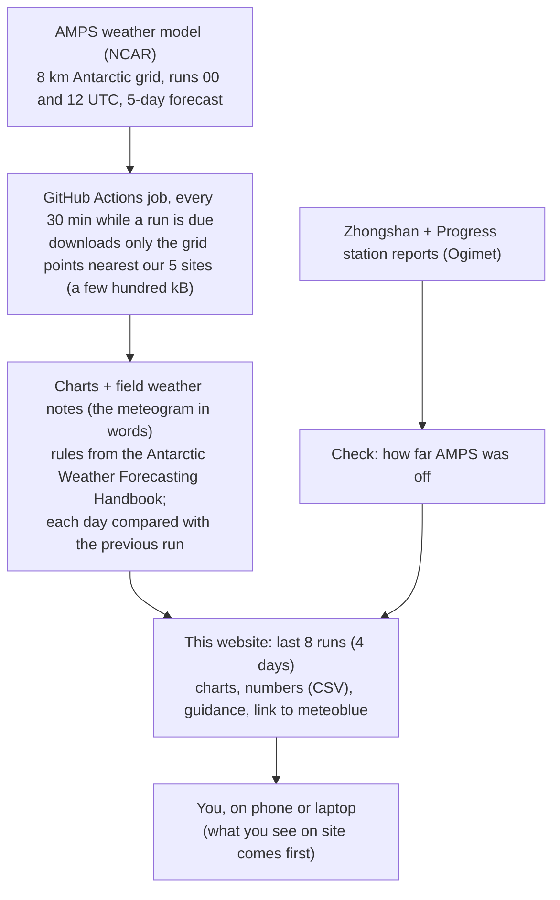

# GSI Grove Mountains Meteograms

Five-day weather guidance for the GSI traverse from Bharati station (Larsemann Hills, Prydz Bay)
inland to the Grove Mountains, east of the Amery Ice Shelf (Antarctica), from the Antarctic
Mesoscale Prediction System (AMPS, NCAR; WRF 8 km).

**Site:** https://vikramonice.github.io/gsi-grove-mountains/

For each of five sites along the traverse (Bharati, R1, R2, R3, Grove Area) the page shows a meteogram (temperature, wind chill, cloud, snow, wind, pressure),
rule-based guidance text, and a running check of AMPS at Bharati against the Zhongshan and Progress
station reports (3 km away; Bharati sends no SYNOP). Charts (PNG) and numbers (CSV) can be downloaded.

Model guidance only, not a forecast: gusts are stronger than the mean wind, and conditions on the
spot come first.

How the field weather notes are written, rule by rule with sources: **[RULES.md](RULES.md)**.

## How it works

## How it updates

A GitHub Actions workflow (`.github/workflows/update.yml`) checks every 30 minutes while a
new AMPS run is due (09:00-12:00 and 21:00-00:30 UTC; runs finish about 10 h after 00/12 UTC). `publish.py` reads the previous state from the `gh-pages` branch, fetches only the few
hundred kB of AMPS GRIB it needs (HTTP byte ranges), makes the charts, guidance and station
check, rebuilds the page (the last 8 runs = 4 days) and force-pushes `gh-pages` as a single
commit. Run it by hand from the Actions tab ("Run workflow"); tick *rebuild* after changing the
page template.

Set up on 2026-10-30 as a copy of the MINIS Meteograms site (vikramonice/minis-weather); the sites,
station check and field-note rules are specific to this traverse. Updates stop after February 2027
(`SEASON_END` in `publish.py`). The site map comes from `code/python/fieldwork/amps_site_map_grove.py`
in the Nivl project.

Data: AMPS, NCAR, run for NSF. Station reports via ogimet.com.
